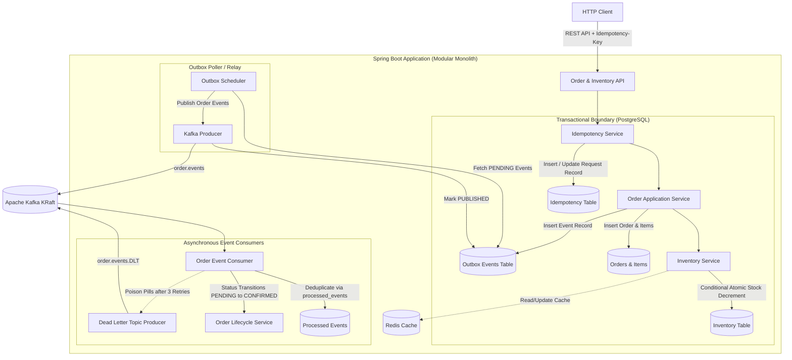

# Distributed Order Processing Platform

[](https://openjdk.org/projects/jdk/21/)
[](https://spring.io/projects/spring-boot)
[](https://kafka.apache.org/)
[](https://www.postgresql.org/)
[](https://redis.io/)
[](LICENSE)

A production-grade, portfolio-quality backend system engineered in **Java 21** and **Spring Boot 3.x** demonstrating distributed systems fundamentals, concurrency control, event-driven architectures, transactional outbox publishing, idempotent Kafka consumers, and resilient caching.

---

## 🎯 Architecture & Engineering Highlights



### 1. Concurrency Control (Zero Overselling)
- **Problem**: Simultaneous checkouts for limited inventory can cause race conditions leading to negative stock.
- **Solution**: Implements **conditional atomic SQL updates**:
  ```sql
  UPDATE inventory
  SET available_quantity = available_quantity - :requestedQuantity,
      reserved_quantity = reserved_quantity + :requestedQuantity,
      updated_at = CURRENT_TIMESTAMP
  WHERE sku = :sku AND available_quantity >= :requestedQuantity;
  ```
  Coupled with **deterministic SKU sorting** (to prevent database deadlocks on multi-item orders) and a database-level `CHECK (available_quantity >= 0)` constraint.
- **Verified**: Automated concurrency tests simulate 50 concurrent threads racing for 10 units of stock with 100% precision.

### 2. Transactional Outbox Pattern (Dual-Write Elimination)
- **Problem**: Writing to PostgreSQL and publishing to Kafka cannot be coordinated atomically without distributed 2PC transactions.
- **Solution**: The order state change and an `OutboxEvent` are committed in the **same local PostgreSQL transaction**. An asynchronous relay scheduler polls unpublished records and dispatches them to Kafka with broker acknowledgment handling.

### 3. Exactly-Once Consumer Deduplication
- **Problem**: Kafka guarantees at-least-once transport; network partitions or consumer rebalances cause duplicate messages.
- **Solution**: Consumers enforce idempotency by inserting composite keys `(event_id, consumer_group)` into a PostgreSQL `processed_events` table within the consumer's local transaction. Duplicate deliveries are safely skipped.

### 4. HTTP Idempotency-Key Header
- **Problem**: Client network retries or double-clicks can generate duplicate orders.
- **Solution**: Evaluates `Idempotency-Key` headers via SHA-256 payload hashing. Replayed requests return cached responses (`200 OK`) without repeating business mutations. Conflicting payloads return `409 Conflict`.

### 5. Resilient Redis Caching (Fail-Open)
- **Capability**: Inventory availability queries (`GET /api/v1/inventory/{sku}`) utilize a cache-aside pattern with automatic invalidation on stock mutation.
- **Resilience**: Redis is treated as an accelerator, not a single point of failure. If Redis experiences downtime or timeouts, the platform gracefully logs a warning and queries PostgreSQL directly without throwing 500 errors.

---

## 🛠️ Technology Stack

| Component | Technology | Rationale |
| :--- | :--- | :--- |
| **Language** | Java 21 LTS | Pattern matching, records, virtual threads, modern garbage collection |
| **Framework** | Spring Boot 3.3.4 | Stable release, Jakarta EE 10, modern native observability |
| **Relational DB** | PostgreSQL 16 | ACID transactions, row-level locking, MVCC, jsonb support |
| **Schema Migrations**| Flyway 10.x | Version-controlled, immutable database evolution (`V1__`, `V2__`) |
| **Event Streaming** | Apache Kafka 3.7+ | KRaft mode (no ZooKeeper dependency), high-throughput event log |
| **Cache** | Redis 7 | Sub-millisecond read latency with fail-open resilience |
| **API Documentation**| Springdoc OpenAPI 2.6.0 | Interactive Swagger UI at `/swagger-ui.html` |
| **Validation** | Jakarta Bean Validation | Declarative request payload contracts |
| **Code Quality** | Checkstyle | Strict adherence to clean formatting and import rules |
| **CI / CD** | GitHub Actions | Automated build, style check, and test verification |

---

## 🚀 Quickstart & Local Setup

### Prerequisites
- **Java 21 LTS**
- **Docker & Docker Compose** (optional: can run with Maven wrapper and embedded components)

### 1. Clone the Repository
```bash
git clone https://github.com/surendra-crax/Distributed-Order-Processing-Platform.git
cd Distributed-Order-Processing-Platform
```

### 2. Start Infrastructure via Docker Compose
Starts PostgreSQL 16, Apache Kafka (KRaft), and Redis 7 with persistent volumes and health checks:
```bash
docker compose up -d postgres kafka redis
```

### 3. Run Automated Tests
Runs unit tests, 50-thread concurrency simulations, Kafka outbox publishing, consumer deduplication, and Redis fallback tests:
```bash
./mvnw clean test
```

### 4. Start the Application Locally
```bash
./mvnw spring-boot:run
```

Or run fully containerized:
```bash
docker compose up -d --build
```

---

## 📖 API Documentation & Swagger UI

Once running, interactive OpenAPI documentation and live API invocation is available at:
👉 **[http://localhost:8080/swagger-ui.html](http://localhost:8080/swagger-ui.html)**

OpenAPI JSON specification: `http://localhost:8080/v3/api-docs`

---

## 📡 REST API Reference

| Method | Endpoint | Description | Status Codes |
| :--- | :--- | :--- | :--- |
| `POST` | `/api/v1/orders` | Create an order with `Idempotency-Key` | `201`, `200` (replay), `400`, `409`, `422` |
| `GET` | `/api/v1/orders/{orderId}` | Get order details and current status | `200`, `404` |
| `GET` | `/api/v1/orders` | List orders (paginated, optional status filter) | `200` |
| `GET` | `/api/v1/orders/{orderId}/events` | Order aggregate event history / audit trail | `200`, `404` |
| `POST` | `/api/v1/inventory/items` | Register a new product SKU | `201`, `400`, `409` |
| `POST` | `/api/v1/inventory/stock` | Replenish inventory stock | `200`, `400`, `404` |
| `GET` | `/api/v1/inventory/{sku}` | Check stock availability (cached) | `200`, `404` |
| `GET` | `/actuator/health` | Service liveness & readiness probes | `200` |

Detailed curl examples for all endpoints and failure scenarios are available in [docs/api-examples.md](docs/api-examples.md).

---

## 🧪 Automated Testing Strategy

The repository contains comprehensive automated tests:

| Test Class | Focus & Verification |
| :--- | :--- |
| `InventoryConcurrencyTest` | Simulates **50 concurrent threads racing for 10 units of stock**. Proves zero overselling, exactly 10 successes, 40 rejections, and final stock = 0. |
| `OrderServiceTest` | Validates server-side `BigDecimal` price computation and strict lifecycle state transitions (`PENDING -> CONFIRMED -> PROCESSING -> COMPLETED`). |
| `OrderApiIntegrationTest` | Tests full HTTP layer: order creation (`201`), idempotent replay (`200`), conflict detection (`409`), and insufficient stock (`422`). |
| `OutboxPublisherIntegrationTest` | Verifies outbox table persistence and background relaying to embedded Kafka brokers with status update to `PUBLISHED`. |
| `KafkaConsumerIntegrationTest` | Tests consumer deduplication via `processed_events`, transition to `CONFIRMED`, and Dead-Letter Topic (DLT) routing for poison pills. |
| `RedisFallbackIntegrationTest` | Verifies cache-aside hit behavior and transparent fail-open fallback to PostgreSQL when Redis experiences outages. |

---

## 📚 Deep-Dive Documentation

- **[docs/architecture.md](docs/architecture.md)** — Architectural design, concurrency control, outbox pattern, and trade-off analyses.
- **[docs/api-examples.md](docs/api-examples.md)** — Realistic curl commands with example responses and RFC 7807 error structures.
- **[docs/failure-recovery.md](docs/failure-recovery.md)** — Runbook for handling broker outages, DLT replays, and cache degradation.

---

## 📄 License
This project is open-source and licensed under the [Apache License 2.0](LICENSE).
