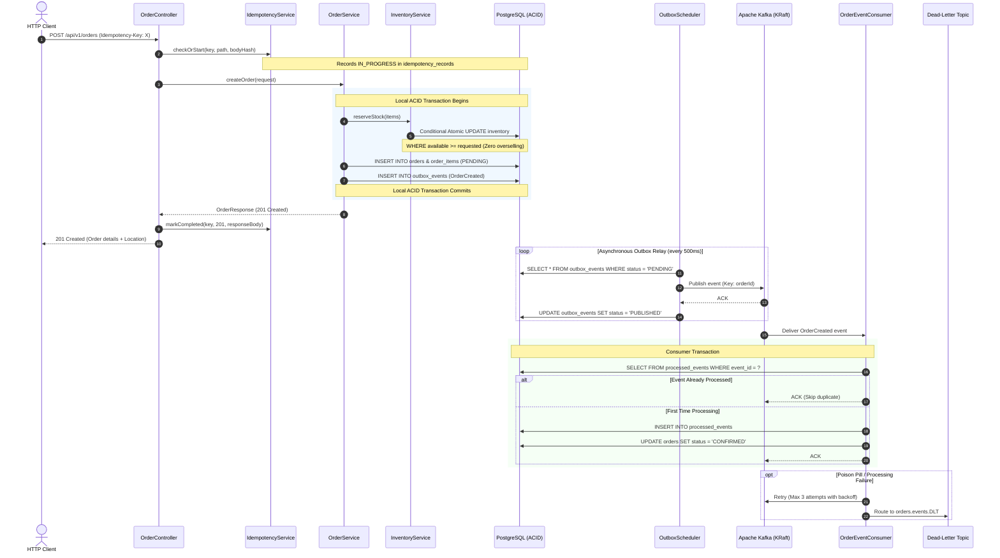

# Architecture & Distributed Systems Design

This document details the architecture, concurrency control strategy, transactional guarantees, and distributed design patterns implemented in the **Distributed Order Processing Platform**.

---

## 1. Modular Monolith Architecture

The platform is designed as a **modular monolith** with clean domain separation. Rather than prematurely creating distributed microservices that introduce operational overhead and network latency, domain boundaries are enforced via package encapsulation and typed contracts:

```
com.platform.orderprocessing/
├── common/        # Shared cross-cutting concerns (RFC 7807 exceptions, MDC correlation)
├── config/        # Infrastructure beans (OpenAPI, Kafka, Redis, Security)
├── inventory/     # Stock tracking, atomic reservations, cache-aside layer
├── order/         # Order aggregate, state machine, financial calculation, REST API
├── idempotency/   # HTTP Idempotency-Key locking, SHA-256 payload hashing
├── outbox/        # Transactional outbox persistence, polling relay scheduler
└── messaging/     # Event schemas, Kafka producers, deduplicated consumers, DLT
```

### Future Microservices Extraction Path
Because domain interactions within transactions are strictly decoupled and all inter-boundary state notifications occur via Kafka events, each module (`inventory`, `order`, `outbox-relay`, `event-consumer`) can be extracted into an independent microservice with zero changes to business logic or database schemas.

---

## 2. End-to-End Workflow & Data Flow



---

## 3. Concurrency Control: Preventing Inventory Overselling

### The Problem
In high-throughput e-commerce systems, flash sales trigger concurrent requests competing for limited stock. Naive "read stock, check in memory, update stock" architectures suffer from **race conditions** (Lost Updates / Read-Modify-Write anomalies), causing inventory to drop below zero (overselling).

### The Implemented Concurrency Solution
We implement a **three-tier defensive strategy**:

1. **Conditional Atomic Updates (Primary Execution)**:
   ```sql
   UPDATE inventory
   SET available_quantity = available_quantity - :requestedQuantity,
       reserved_quantity = reserved_quantity + :requestedQuantity,
       updated_at = CURRENT_TIMESTAMP
   WHERE sku = :sku AND available_quantity >= :requestedQuantity;
   ```
   - **Why this is optimal**: Relies on PostgreSQL's row-level MVCC write-lock. The database engine evaluates `available_quantity >= :requestedQuantity` atomically at the moment the lock is acquired.
   - If multiple threads attempt to reserve the last unit simultaneously, only one transaction updates the row (returns row count `1`). The remaining transactions return row count `0`, triggering an immediate `InsufficientInventoryException` (HTTP 422) and rolling back cleanly without database deadlocks.

2. **Deterministic Lock Ordering for Multi-Item Orders**:
   - When an order contains multiple SKUs (e.g., SKU-A and SKU-B), concurrent transactions reserving {A, B} and {B, A} could deadlock if locks are acquired out of order.
   - We enforce alphabetical sorting by SKU before executing reservations:
     ```java
     List<String> sortedSkus = items.keySet().stream()
             .sorted(Comparator.naturalOrder())
             .toList();
     ```
   - This eliminates lock hierarchy inversion and prevents database deadlocks.

3. **Database Engine CHECK Constraint (Ultimate Safety Boundary)**:
   ```sql
   available_quantity INT NOT NULL CHECK (available_quantity >= 0)
   ```
   - Even if application logic had a defect, PostgreSQL strictly rejects any write resulting in negative inventory.

---

## 4. Dual-Write Elimination: The Transactional Outbox Pattern

### The Problem
When an application must update a database and publish a message to Kafka, network partitions or process crashes create inconsistency:
- **Write to DB first, publish to Kafka second**: If Kafka is unreachable or the application crashes before publishing, the database has changed but downstream consumers never receive the event.
- **Publish to Kafka first, write to DB second**: If the database transaction rolls back, downstream consumers have processed a phantom order that does not exist.
- **Two-Phase Commit (2PC / XA)**: Heavy, poorly supported across modern cloud infrastructure, and creates distributed latency bottlenecks.

### The Implemented Outbox Solution
1. **Single ACID Transaction**: The order mutation, inventory reservation, and the outgoing `outbox_events` record are saved in the **exact same PostgreSQL transaction**.
2. **Asynchronous Polling Relay**:
   - A background scheduler (`OutboxScheduler`) polls pending outbox records:
     ```sql
     SELECT * FROM outbox_events WHERE status = 'PENDING' ORDER BY created_at ASC LIMIT 50;
     ```
   - Dispatches each message to Kafka with the `orderId` as the partition key.
3. **Broker Acknowledgment**:
   - Upon receiving the Kafka broker ACK (`RecordMetadata`), status is updated to `PUBLISHED` with `published_at = CURRENT_TIMESTAMP`.
   - On error: increments `retry_count` with exponential backoff.
4. **Guarantees**: Delivers **at-least-once** event transmission to Kafka with zero dual-write vulnerabilities.

---

## 5. Consumer Idempotency: Achieving Exactly-Once Business Effects

### At-Least-Once Delivery vs. Exactly-Once Processing
Kafka provides at-least-once message delivery. Consumer rebalances, network timeouts, or consumer crashes can cause duplicate messages to be redelivered.

### Consumer Deduplication Table (`processed_events`)
To achieve **exactly-once business effects**, each consumer group tracks processed event IDs in PostgreSQL:

```sql
CREATE TABLE processed_events (
    event_id UUID NOT NULL,
    consumer_group VARCHAR(64) NOT NULL,
    processed_at TIMESTAMP WITH TIME ZONE NOT NULL DEFAULT CURRENT_TIMESTAMP,
    PRIMARY KEY (event_id, consumer_group)
);
```

Within the consumer transaction:
1. The consumer queries `processedEventRepository.existsById(new ProcessedEventId(eventId, consumerGroup))`.
2. **If duplicate detected**: Logs info and immediately acknowledges the Kafka offset without repeating business actions.
3. **If new event**: Inserts deduplication record and transitions the order status to `CONFIRMED` in the same transaction.

---

## 6. Dead-Letter Topic (DLT) & Failure Handling

When a consumer encounters an unrecoverable failure (such as a malformed message or downstream outage):
1. **Spring Kafka `DefaultErrorHandler`** catches the exception.
2. Executes **3 retry attempts** with a 1000ms backoff interval.
3. If all retries exhaust, `DeadLetterPublishingRecoverer` forwards the poison pill to `order.events.DLT`.
4. Kafka headers preserve:
   - `kafka_original-topic`
   - `kafka_original-partition`
   - `kafka_original-offset`
   - `kafka_exception-message`
   - `kafka_exception-stacktrace`
5. The main consumer group unblocks and continues processing healthy events without stalling the pipeline.

---

## 7. HTTP API Idempotency (`Idempotency-Key`)

To protect clients from accidental duplicate submissions (double clicks, network retries):
1. Clients provide an `Idempotency-Key: <UUID>` header.
2. `IdempotencyService` calculates the SHA-256 hash of the request body and endpoint URI.
3. **Key States**:
   - `IN_PROGRESS`: A request with this key is actively executing. Any concurrent request with the same key receives `409 Conflict`.
   - `COMPLETED`: Previous request finished.
     - **Matching payload hash**: Returns the cached response body and HTTP status (`200 OK`) without re-executing order creation or reserving duplicate stock.
     - **Mismatched payload hash**: Client attempted to reuse the same idempotency key for a different order. Returns `409 Conflict`.
4. **Retention**: Records expire after 24 hours and are cleaned up via automated hourly maintenance (`@Scheduled(cron = "0 0 * * * *")`).

---

## 8. Redis Caching & Resilient Fallback (Fail-Open)

- **Capability**: Inventory availability queries (`GET /api/v1/inventory/{sku}`) are read-heavy and latency-sensitive.
- **Cache Strategy**: Cache-Aside (Lazy Loading) with Jackson JSON serialization and 300s TTL.
- **Cache Invalidation**: On inventory mutation (reservation, replenishment, or cancellation), the cache key `inventory:sku:{sku}` is evicted.
- **Fail-Open Resilience**:
  - Redis is treated as a performance accelerator, **never as a point of failure**.
  - All Redis operations are wrapped in defensive try-catch handlers.
  - If Redis is down, unreachable, or times out, the service logs a warning and queries PostgreSQL directly.
  - PostgreSQL is the sole authoritative source of truth.
